<!-- The SVG cards in /assets come from scripts/build-assets.mjs. The activity card is rebuilt daily by .github/workflows/activity.yml. -->

  

  
  &nbsp;
  

I build production mobile apps and the backend systems behind them. I've written React and React Native professionally since 2021: card features and an Apple Wallet extension for a bank, a large JavaScript-to-TypeScript migration, and now full-stack work where I own features from backend architecture to production rollout, on-call included.

Outside work I like taking unfamiliar systems apart to see how they behave: game runtimes, replay and simulation tooling, and development workflows built around AI coding agents.

## Experience

  

  

<b>Full role descriptions</b>

 

**Senior Full-Stack Developer, Mobile & Backend** · Piletilevi PLG · Jun 2026 – present

A full-stack role with growing ownership of backend architecture, production systems and end-to-end delivery.

- Own features end to end: technical design and backend architecture, API and service implementation, frontend integration and production rollout
- Build new backend services and extend existing systems to support new product capabilities
- Investigate and fix complex production issues across backend and frontend
- Part of the on-call rotation: respond to production incidents and ship reliable fixes under time pressure
- Work with product and engineering to turn requirements into maintainable, production-ready solutions

**React Native Developer** · Piletilevi PLG · Jan 2025 – Jun 2026

- Built an automation pipeline that converts Figma color tokens into fully typed code objects, removing manual color-mapping errors
- Designed a strongly typed component variant system, so UI changes became configuration of reusable variants instead of complex conditionals
- Refactored a large legacy JavaScript codebase into modern TypeScript, improving long-term stability and developer productivity

**Mobile Application Developer** · Partners Banka · Feb 2023 – Jan 2025

- Implemented card features as part of the cards team, in React Native and iOS
- Developed an Apple Wallet extension with Apple's SDK for a smoother card tokenization flow
- Worked with QA, UI/UX and product owners to ship features smoothly

**Marketing Technology Specialist** · Fortuna Entertainment Group · Jun 2022 – Feb 2023

- Managed Google Tag Manager to track user behavior and optimize marketing campaigns
- Built and ran targeted campaigns in Exponea (Bloomreach)
- Analyzed campaign performance to make data-driven decisions

**React Developer** · Onlio · Jun 2021 – Dec 2021

- Fixed bugs and implemented features in React, working alongside senior developers

**Automated Software Testing** · Onlio · May 2021 – Jul 2021

- Maintained Cypress tests and expanded test coverage for Onlio's React-based platform

## Stack

  

## Selected work

### [ReTake](https://github.com/N0deNinja/ReTake)

Rewind and retry for **skate.** on PC, built as a mod on the open-source [ReSkate](https://github.com/Dingo-Shenanigans/ReSkate) framework. Mess up anywhere in a line, pick an earlier moment on a timeline, and carry on from there. ReTake doesn't teleport you back. It replays your recorded inputs at accelerated speed until it reaches that moment, then slows down, counts you in and hands the controls back.

- **Input recording and locked replay.** A `reskate.tas` plugin API added to the native runtime (C++) records a line's inputs on every physics step and replays them locked to the recording.
- **Game-time control.** Accelerated catch-up from 1× to 8×, a countdown hand-off back to the player, and slow motion that rescales the board's flight so it works mid-air.
- **Timeline UI in Luau.** Scrub the line with a ghost skater, replace the rest of a line with a new attempt, and play every best attempt back as one run.
- **Packaging.** A one-click installer with backup and uninstall, offline-only by design, and a native build that never uploads crash reports.

Building it meant working inside a game runtime I didn't write: learning how its physics steps, grinds and bails behave, then a lot of iterative debugging to make replays line up.

Early release (v0.0.1). Replays can still drift on rails and ledges; this is listed in the repo's known issues.

### Counter-Strike 2 server plugins

Server-side gameplay features in C# on .NET 8 with CounterStrikeSharp: game event handling, player state, chat commands and persistent data.

<table>
<tr>
<td width="50%" valign="top">

**[ServerCoreBySeen](https://github.com/N0deNinja/ServerCoreBySeen)** 
A modular plugin pack: XP and ranking stored in SQLite through Dapper, configurable rewards for kills, headshots, bomb plays and round results, VIP perks by SteamID, scoreboard tags, and per-module config.

</td>
<td width="50%" valign="top">

**[RankingSystem](https://github.com/N0deNinja/CS2---Ranking-System-Plugin)** 
An earlier, single-purpose plugin: points for kills, deaths and round results, a leaderboard that persists between restarts, and `!rank` / `!top15` chat commands with a colour-coded table.

</td>
</tr>
</table>

## Working with AI coding agents

  

I use coding agents such as Claude Code and OpenAI's coding tools in my everyday engineering, including workflows where agents write a large share of the code. What makes that work is everything around the agent: a clear spec, understanding the target system before changing it, splitting the problem into pieces an agent can own, then reviewing, debugging and testing what comes back before it goes in. Used that way, agents have let me build complex prototypes and working tools much faster. They don't replace knowing how the software works.

## Activity

  

## Currently exploring

`developer tooling & automation` `agentic software engineering` `game engine integrations` `simulation & replay systems` `cross-platform architecture`

 

  Prague, Czech Republic · <a href="https://dvorakstudio.dev">dvorakstudio.dev</a> · <a href="https://www.linkedin.com/in/georgedvorakdev/">LinkedIn</a>

